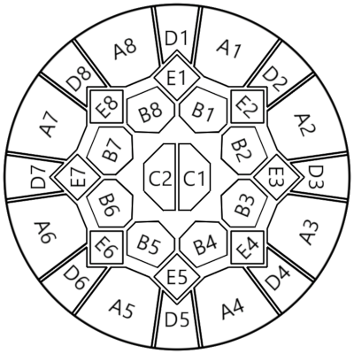
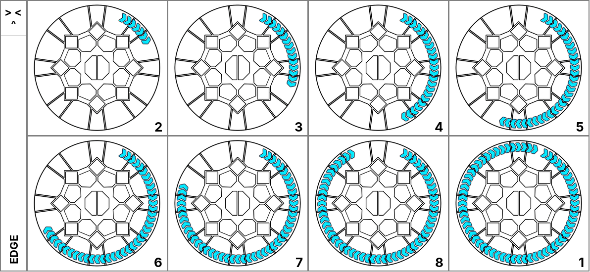
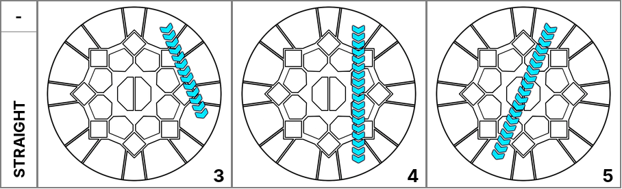
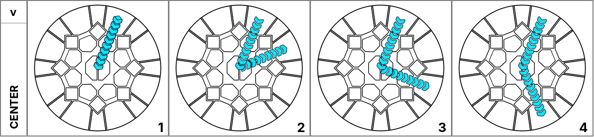
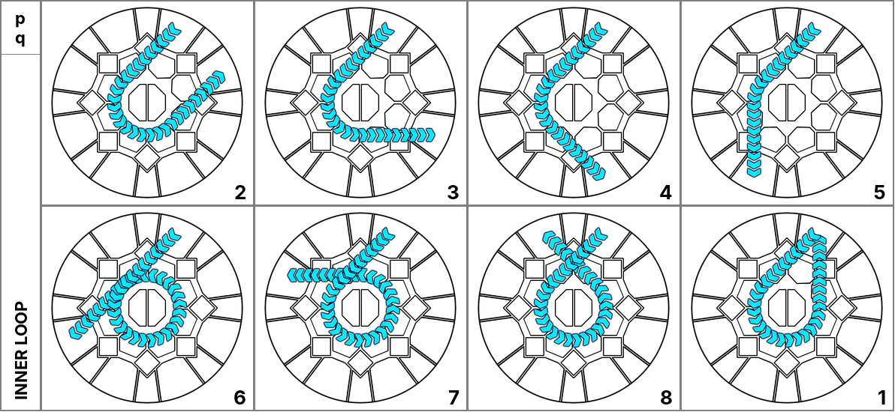
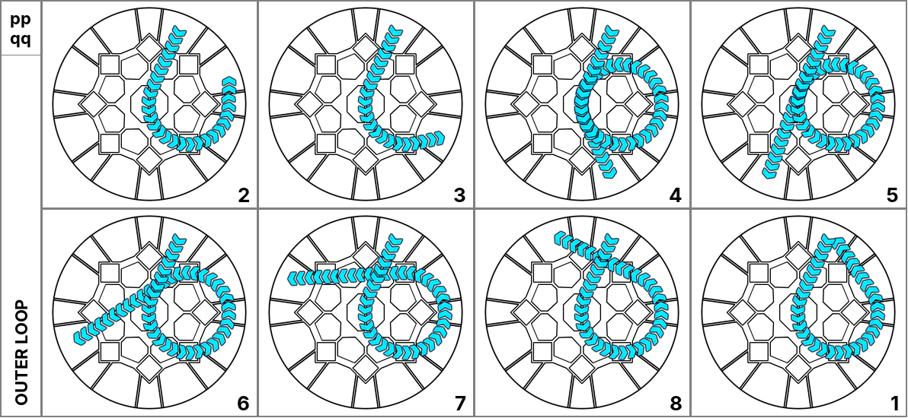
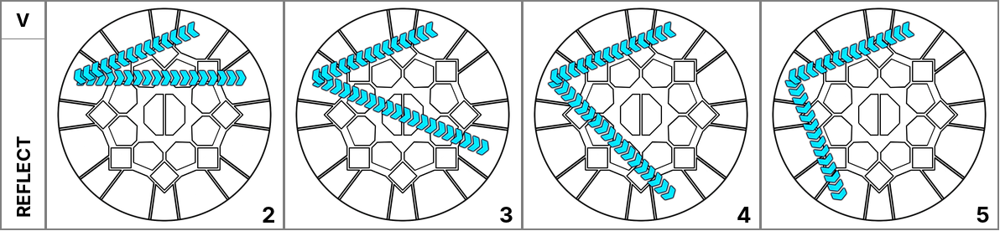
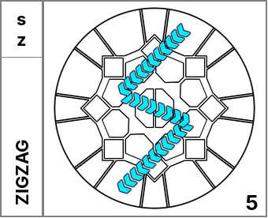
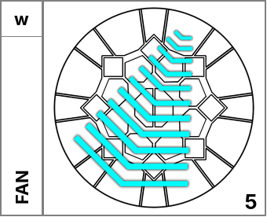

# Minimai Level Data Format

## Types

### Button

The 8 ring buttons, clockwise: `1` (upper right) … `8` (upper left).

### Sensor

Touch sensors:

* N0 = 0: None.
* A1 .. A8 = 1 .. 8: Outer ring.
* B1 .. B8 = 9 .. 16: Inner ring.
* C = 17: Center.
* D1 .. D8 = 18 .. 25: Outer ring, between A sensors.
* E1 .. E8 = 26 .. 33: Inner ring, between B sensors.

### SlideTrackKind

Tracks are defined starting from button 1. `button` rotates them, `isMirrored` mirrors them across the button-1 axis. "End" is the end button for a start at button 1, unmirrored.

* CIRCLE_1 .. CIRCLE_8 = 1 .. 8: Clockwise arc along the ring, ending at button 1 .. 8.

* LINE_3 .. LINE_5 = 9 .. 11: Straight line to button 3 .. 5.

* CENTER_1 .. CENTER_4 = 12 .. 15: Through the center (`v`) to button 1 .. 4.

* LOOP_IN_1 .. LOOP_IN_8 = 16 .. 23: Counter-clockwise curve around the center (`p`) to button 1 .. 8.

* LOOP_OUT_1 .. LOOP_OUT_8 = 24 .. 31: Large curve (`pp`) to button 1 .. 8.

* REFLECT_2 .. REFLECT_5 = 32 .. 35: Two lines turning at button 7 (`V`) to button 2 .. 5.

* ZIG_ZAG = 36: `s` shape to button 5.

* FAN = 37: Wi-Fi, three stars to buttons 4, 5 and 6.

* FAN_L = 38, FAN_C = 39, FAN_R = 40: [Internal] The three Wi-Fi branches, ending at buttons 6, 5 and 4. Not valid in level data.

## Initialization

Handles common initialization logic for the engine. Must appear exactly once as the first entity in level data.

### Fields

* **countInBpm (float)**: Tempo of the count-in ticks before the first note (simai `&wholebpm`). 0 or less is no count-in. Defaults to 0.

## #BPM_CHANGE

The standard bpm change archetype.

### Fields

* **#BEAT (float)**
* **#BPM (float)**

## *Note

Comprised of many archetypes according to the following naming scheme:

[![][note_diagram]](https://tabatkins.github.io/railroad-diagrams/generator.html#Diagram%28Sequence%28Choice%280%252C%20%27Normal%27%252C%20%27Ex%27%252C%20Sequence%28Optional%28%27Ex%27%252C%20%27skip%27%29%252CChoice%280%252C%20%27Each%27%252C%20%27Break%27%29%29%29%252CChoice%280%252C%20%27Tap%27%252C%20%27Star%27%252C%20%27DoubleStar%27%29%29%252C%20%27Note%27%29)

A star note is usually the head of a slide (see **headNote** below). Double stars are used when more than one slide starts from the same star.

### Fields

* **#BEAT (float)**
* **button (Button)**: Defaults to 1.
* **speed (float)**: Note speed multiplier. Defaults to 1.
* **rotateSpeed (float)**: Star spin in half-turns per second; positive is clockwise. Used only when **hasCustomRotation** is set; 0 means no spin. Defaults to 0.
* **hasCustomRotation (bool)**: Whether **rotateSpeed** is used. Otherwise a star spins at the speed set by the slide that uses it as **headNote**, or at the fake-rotation speed (440°/s, simai `$$`) when no slide does. Taps never spin unless this is set. Defaults to false.
* **firework (bool)**: Plays firework effects when hit. Defaults to false.

## *HoldNote

Comprised of many archetypes according to the following naming scheme:

[![][hold_diagram]](https://tabatkins.github.io/railroad-diagrams/generator.html#Diagram%28Sequence%28Choice%280,%20%27Normal%27,%20%27Ex%27,%20Sequence%28Optional%28%27Ex%27,%20%27skip%27%29,Choice%280,%20%27Each%27,%20%27Break%27%29%29%29%29,%20%27HoldNote%27%29)

### Fields

* **#BEAT (float)**
* **button (Button)**: Defaults to 1.
* **holdDuration (float)**: Beats from the head to the end. 0 is a hold that ends with its head. Defaults to 0.
* **speed (float)**: Note speed multiplier. Defaults to 1.
* **firework (bool)**: Plays firework effects at the end, unless missed. Defaults to false.

## *TouchNote

Comprised of many archetypes according to the following naming scheme:

[![][touch_diagram]](https://tabatkins.github.io/railroad-diagrams/generator.html#Diagram%28Choice%280,%20%27Normal%27,%20%27Each%27,%20%27Break%27%29,%20%27TouchNote%27%29)

### Fields

* **#BEAT (float)**
* **sensor (Sensor)**
* **speed (float)**: Note speed multiplier. Defaults to 1.
* **group (ref?[TouchNote | TouchHoldNote])**: The touch group leader, see [Touch groups](#touch-groups).
* **groupSize (int)**: Members in the touch group. Defaults to 0.
* **firework (bool)**: Plays firework effects when hit. Defaults to false.

## *TouchHoldNote

Comprised of many archetypes according to the following naming scheme:

[![][touch_hold_diagram]](https://tabatkins.github.io/railroad-diagrams/generator.html#Diagram%28Choice%280,%20%27Normal%27,%20%27Each%27,%20%27Break%27%29,%20%27TouchHoldNote%27%29)

Note: Each and break only change the centre point (and break scores as a break).

### Fields

* **#BEAT (float)**
* **sensor (Sensor)**
* **holdDuration (float)**: Beats from the head to the end. 0 is a touch hold that ends with its head. Defaults to 0.
* **speed (float)**: Note speed multiplier. Defaults to 1.
* **group (ref?[TouchNote | TouchHoldNote])**, **groupSize (int)**: The touch group, as for touch notes.
* **holdGroup (ref?[TouchHoldNote])**: The body group leader, see [Touch groups](#touch-groups).
* **holdGroupSize (int)**: Members in the body group. Defaults to 0.
* **firework (bool)**: Plays firework effects at the end, unless missed. Defaults to false.

## Touch groups

[Transient]

Touches and touch holds at the same beat whose sensors are next to each other (chained: A1, then the sensors next to A1, and so on) form a touch group. Each member's **group** refers to the group's first member (that member refers to itself), and **groupSize** is the number of members. Groups of one are left out.

* **Head:** once more than half of the group is hit (misses don't count), every member still waiting is judged like the hit that took the group past half, with the same timing error.
* **Body:** the touch holds of a touch group form its body group (**holdGroup** / **holdGroupSize**, same convention). While more than half of them are held, every member's body counts as held.

## EachLine

[Transient]

The arc between two taps, holds or star heads hit together. The notes at one beat are joined in chart order: the first to the second, the second to the third, and so on, skipping pairs on the same button. The arc runs the shorter way round (at most 4 buttons), moves with the notes (a tap if there is one, otherwise the hold head) and disappears with the first of the two notes.

### Fields

* **left (ref[Note | HoldNote])**: The first note.
* **right (ref[Note | HoldNote])**: The second note.

## Slides

A slide is one entity, or a chain of entities linked by **prevSlide** / **nextSlide**. Every chain has exactly one head (no **prevSlide**) and one or more final slides (no next).

[![][slide_diagram]](https://tabatkins.github.io/railroad-diagrams/generator.html#Diagram%28Choice%280,%20%27Normal%27,%20%27Each%27,%20%27Break%27,%20%27Conn%27%29,%20Optional%28%27Wifi%27,%20%27skip%27%29,%20%27SlideNote%27%29)

Conn slides are not scored and take their colour (normal / each / break) from the chain's final slide reached by following the center, then left, then right branch.

### Timing

All segments of a chain use the same **#BEAT** (the star note time). The chain head waits **waitDuration**, then the star travels the whole chain at a constant speed:

1. **slideDuration** is summed from the head to each final slide, giving that path's total travel time.
2. The total is split across the path's segments by track bar count.
3. A conn slide takes its speed from its primary final (center, then left, then right). A final slide on another branch gets the rest of its own path total.

Writing the chain's total on the final slide and 0 on every conn slide is the usual form. Per-segment values also work; only their sum along each path matters.

### Fields

* **#BEAT (float)**: The star note time, shared by every segment of a chain.
* **track (SlideTrackKind)**: FAN for Wi-Fi archetypes.
* **button (Button)**: Start button. For a later segment, the end button of the parent (or of the parent's Wi-Fi branch). Defaults to 1.
* **isMirrored (bool)**: Mirror the track across the start button's axis.
* **waitDuration (float)**: Beats between **#BEAT** and the star starting to move. Only read on the chain head.
* **slideDuration (float)**: Beats. Summed along each path; see [Timing](#timing).
* **speed (float)**: Note speed multiplier for the fade-in. Defaults to 1.
* **headNote (ref?[*Note])**: The star (or tap) note the slide starts from. Only meaningful on the chain head. The slide sets the star's spin speed from the chain's length and duration.
* **prevSlide (ref?[Slide])**: The previous segment. Unset on the chain head.
* **firework (bool)**: Plays firework effects when the star arrives, unless missed. Defaults to false. Does nothing on ConnSlides

ConnSlideNote also has:

* **nextSlide (ref[Slide])**: The next segment.

ConnWifiSlideNote also has:

* **nextSlide (ref?[Slide])**: The segment continuing from the center branch (end button 5).
* **nextSlideL (ref?[Slide])**: The segment continuing from the left branch (end button 6).
* **nextSlideR (ref?[Slide])**: The segment continuing from the right branch (end button 4).

At least one of the three must be set.

## Planned

* Fireworks: **firework** only plays a sound so far.

[note_diagram]: img/note_rr_diagram.png
[hold_diagram]: img/hold_rr_diagram.png
[touch_diagram]: img/touch_rr_diagram.png
[touch_hold_diagram]: img/touch_hold_rr_diagram.png
[slide_diagram]: img/slide_rr_diagram.png